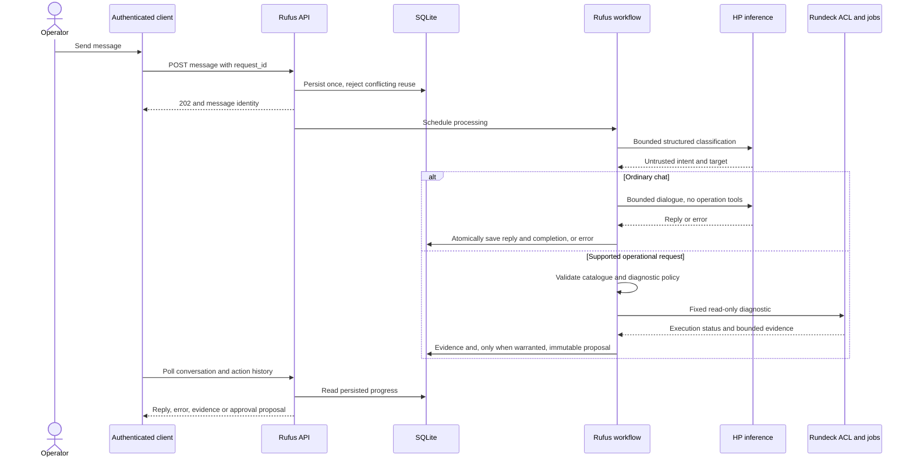
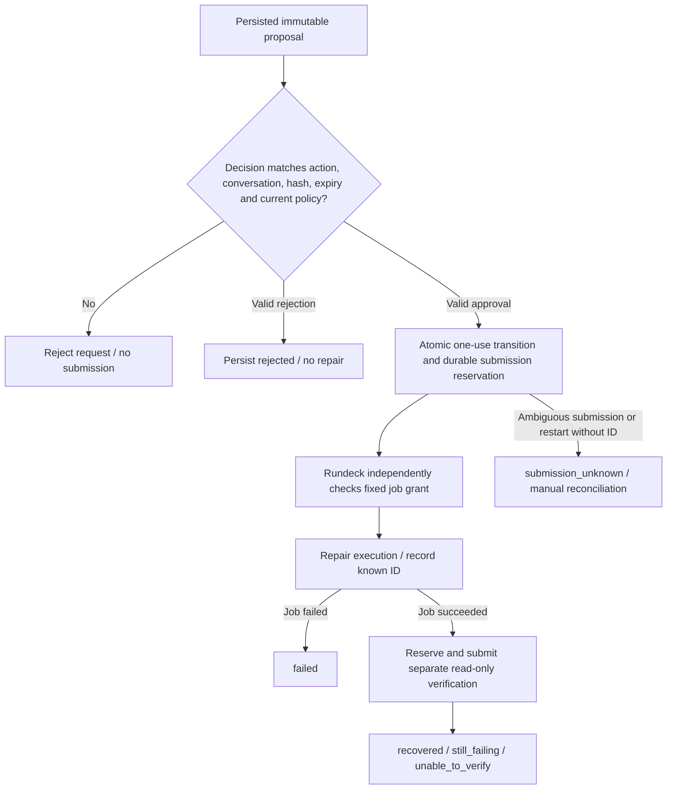

# AI2 conversational API contract

Contract drafted before implementation, 2 November 2026. User approved the
APT-cache target, listed read-only diagnostics and an isolated disposable fixture.
Every repair still requires an exact action approval. Publication and deployment
were separately explicitly approved.

All endpoints remain on Rufus loopback (`127.0.0.1:8787`) and require the existing
bearer credential. Existing `/health`, `/jobs`, `/executions` and execution-status
routes remain supported. Future LAN/VS Code transport is a separate task.

## Conversations and progress

| Method | Route | Request/result |
|---|---|---|
| POST | `/conversations` | Empty object creates a durable conversation; returns its ID |
| GET | `/conversations/ID` | Messages, timestamped progress/evidence and linked actions |
| POST | `/conversations/ID/messages` | `request_id` and `content`; persist once and return HTTP 202 with message ID/status |
| GET | `/actions/ID` | Exact immutable proposal, approval state, execution, verification and final outcome |
| POST | `/actions/ID/decision` | `conversation_id`, `proposal_hash`, and `decision` (`approve` or `reject`) |

IDs are opaque server-generated UUIDs. Message request IDs are client-generated
UUIDs, unique within a conversation. Retrying the same ID/content returns the
original message; changing its content returns conflict. A conversation accepts
one active request at a time. Message text and model/diagnostic context are bounded.
Polling provides persisted progress and final results without keeping an HTTP
request open for model generation or Rundeck execution. No streaming framework is
needed for this milestone.

## AI3 conversation extension

Ordinary messages now receive locally generated conversational replies without
Rundeck operations. History messages include `role: user` or `role: assistant`;
assistant messages include `reply_to` linking the originating user message.
Assistant output and successful user-message completion persist atomically.
The POST still returns 202; poll history for completion or a persisted error.
Existing operational proposals and decision endpoints retain their AI2 rules.
See [AI3](ai3.md) for bounded dialogue context, errors and live acceptance.

## Conversation and execution flow



In words: message acceptance is asynchronous and idempotent; the client polls
persisted results. Chat cannot invoke jobs. Operational classification must pass
application policy before a diagnostic reaches Rundeck; healthy/unavailable or
unsupported requests do not become repair submissions. The workflow executor is
local application concurrency, not a distributed HP/Dell worker scheduler.

## Proposal and approval

An action is persisted before it is returned for approval. It includes:

- Conversation and request identity.
- Stable operation, permitted target, exact options and Rundeck job UUID.
- Exact change, expected effect, material risks and recovery limitations.
- Diagnostic evidence/execution IDs and timestamps.
- Expiry and a digest binding all immutable execution/approval fields.
- Status, repair execution ID, independent verification ID and final outcome.

Approval is accepted only for that action, conversation, hash and unexpired state.
The state transition is atomic and one-use. Rejection, expiry, replay, changed
parameters or changed catalogue policy prevents submission. Model output, job
logs and repository text never count as approval. Direct `/executions` requests
must reject every operation marked as requiring approval, preventing an alternate
route around the conversation state machine.

Persist a submission reservation before each external POST. Never retry an
ambiguous POST. If submission outcome cannot be recorded or is unknown after a
restart, report that uncertainty and require manual reconciliation. Resume
monitoring known execution IDs; never automatically resubmit a repair. Pending
approvals and active executions survive restart. Interrupted inference may be
reported as interrupted rather than regenerated automatically.

A successful repair job produces an executed state, not a recovered claim.
Independent verification must complete and its evidence must establish the
original fault is resolved. Outcomes distinguish `recovered`, `still_failing`,
`unable_to_verify`, `failed`, `submission_unknown`, `rejected` and `expired`.

### Exact-action decision and recovery boundary



In words: an authenticated operator must approve the exact proposal once. Model
output and logs are not approval; direct mutation submission cannot bypass this
path. A successful repair is only execution evidence. Recovery needs independent
verification; unknown submission outcomes are never automatically retried.
Known execution IDs can resume monitoring after restart.

## Trust and operation catalogue

The model interprets bounded user/evidence context and proposes structured data.
Application validation and independent Rundeck ACLs enforce operations, targets,
parameter names/types/ranges and approval policy. No arbitrary UUID, shell command,
infrastructure SSH credential, sudo permission or dynamic tool authorisation is
accepted. Catalogue changes are deliberate Git/Ansible/Rundeck changes.

Every catalogue entry must specify classification, permitted target and options,
exact job UUID, whether diagnostics are pre-approved, expected outcome, verification
operation and timeout/retry policy. Mutations have no automatic retries. Diagnostic
output is untrusted data, bounded and redacted before persistence/model context.
Secrets and upstream exception bodies must not appear in API errors or model input.

## Approved first workflow

Target: `apt-cache.lan`, service `apt-cacher-ng`. Read-only diagnostics: host
availability, service state, cache-filesystem free space and HTTP response.
Repair: restart only that existing service, after explicit approval. Verification
uses a separately invoked read-only operation and HTTP evidence. Inspect host
availability before diagnosing configuration; do not change SSH/network settings
because a host is unavailable.

AI2 acceptance used an approved isolated disposable fixture because production
was healthy. It had distinct operation/target identities and has since been
removed. Any future real-fault acceptance needs a genuine fault or a newly agreed
disposable fixture; never manufacture a production outage or silently redirect
a production proposal to a test target.

## Implementation status — 2 November 2026

The conversational API, inference orchestration, persistent approvals, fixed
operation catalogue and independent restricted ACL are deployed. Latest deployment:
[183](http://192.168.0.51:4440/project/HomeLab/execution/show/183), source `3277356`.
HP was awakened through Rundeck execution 175. No production service was changed.

Final scripted validation passed all six groups; controller logs:
`/tmp/homelab-validation-51fbsm0p`. The controller required the missing `jq`
dependency and validation runs as the checkout owner, `rundeck`.
Live checks passed Rufus operation denial, direct mutation bypass denial and
independent Rundeck denial. Fixture diagnostic execution 184 confirmed a stopped
fixture and failed HTTP probe with sufficient disk space. Rejecting action
`25a1066a-27ad-4bb1-ac88-d14fdaecec07` created no repair execution.

Real inference exposed target and intent classification errors. Explicit fixture
requests now constrain the validated target schema; explicit repair/restart
requests permit proposal, clarification or unsupported responses. Model responses
still cannot approve or execute an operation. A regression check rejects model
selection of production for an explicit fixture request.

Acceptance completed with explicitly approved action
`3528d3c1-5867-4ac6-abd3-f987444eb0fb`: diagnostic
[187](http://192.168.0.51:4440/project/HomeLab/execution/show/187), repair
[188](http://192.168.0.51:4440/project/HomeLab/execution/show/188), independent
verification [189](http://192.168.0.51:4440/project/HomeLab/execution/show/189).
The persisted outcome is `recovered`; verification established active service and
successful HTTP response. Earlier expired approval was rejected without execution.

At the user's request, cleanup deployment
[191](http://192.168.0.51:4440/project/HomeLab/execution/show/191) removed the
fixture service, configuration, cache, logs and runtime directory. Fixture jobs,
Rufus catalogue/policy entries and restricted ACL grants were retired. Default
deployment now removes the fixture rather than recreating it. Mock fixture data
remains only under `tests/rufus/fixtures` for offline regression tests.
Final single-script verification passed all six validation groups, fixture
absence, removal of live test operations/jobs, and production service/HTTP health.
Logs: `/tmp/homelab-validation-hunht6eq`. Cleanup source: `3cf858b`.
AI2's one supervised repair milestone is complete; no broader autonomy was added.

## Deployment permissions

Rundeck's service identity can administer the existing remote guests, but has no
passwordless sudo on the controller itself. Preserve that boundary. After Git
checkout/job sync, install the versioned restricted ACL using the existing Ian
administrative context on Rundeck:

```bash
cd /opt/homelab-server-builds
sudo env ANSIBLE_ROLES_PATH="$PWD/Ansible/roles" ansible-playbook \
  -i Ansible/inventory/ai2.ini --limit rundeck_controller \
  --tags ai2_configuration Ansible/playbooks/ai2.yml
```

Then **HomeLab - Deploy Rufus AI2** (`34053c09-7207-4ac4-a89f-24fd1c595976`)
refreshes Git, deploys the Rufus application and enforces removal of the completed
APT-cache fixture through Ansible. It cannot approve or execute a repair. No controller sudo grants are
added. The catalogue and `policy.json` record every exact permitted operation,
job UUID, target, empty option schema, classification, approval policy and timeout.
After acceptance cleanup, only the existing health check and three production
APT-cache diagnostic/restart/verification job UUIDs are permitted to `rufus-api`.


## Real acceptance client

`scripts/ai2-acceptance.py` is deployed under `/opt/rufus/app`. Run as the
unprivileged service user. Its `propose`, `reject`, `status` and `boundaries`
stages never approve repairs. `approve` requires explicit action ID and hash
arguments supplied only after the user approves that concrete proposal. State
persists in `/opt/rufus/data/ai2-acceptance.json`; no credentials are printed.
The acceptance fixture used loopback port 13142 and separate configuration,
cache, logs and systemd unit. It has now been removed along with its live
operations. Production port 3142 and its service were unchanged. The historical
acceptance client is not a fixture provisioner and cannot rerun retired operations.
