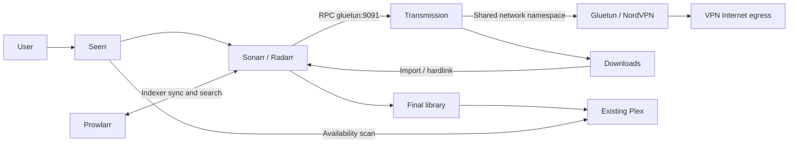

# Bobarr replacement: Seerr on native TerraMaster TOS

**4 November 2026 — local design and templates only; UNVALIDATED on TOS.**
No containers started, images pulled, NAS contacted, disks operated on or services
deployed. Four-disk TRAID synchronisation is user-reported and left untouched.
The installed TOS/Docker/Compose versions, paths, ACLs and current Plex deployment
are unknown. Historical Proxmox/ZFS descriptions elsewhere are not deployment inputs.

This supersedes MEDIA-01's custom Boba frontend, optional specialist backends and
Debian VM proposal for this media project. Use Seerr's existing interface rather
than developing or copying Bobarr. No Bobarr source or dependency reuse is proposed;
no Bobarr implementation was found in the repository. Rufus infrastructure remains
unchanged. The media stack works without workers, Rufus or OpenClaw.

## Responsibilities and dependencies

| Service | Owns | Needs / does not own |
|---|---|---|
| Seerr | Discovery, users, request approval and request/availability records | Calls Sonarr for TV and Radarr for films; reads Plex availability. Does not download, rename or play media. SQLite persisted in `/app/config`; PostgreSQL optional. No Redis required by the documented installation. |
| Sonarr | TV monitoring, quality choices, release selection, download queue tracking and TV import/rename/history | Indexer API (Prowlarr here), Transmission RPC and writable download/library paths. Can operate without Seerr. |
| Radarr | Equivalent film lifecycle and film import/history | Same integrations as Sonarr; separate configuration/database. |
| Prowlarr | Indexer definitions, credentials, searches and indexer synchronisation to Sonarr/Radarr | Calls their APIs and indexer sites. No media mounts. Not the automatic import manager or a mandatory upstream for Seerr. |
| Transmission | BitTorrent transfer, resume state and seeding | Receives jobs from Sonarr/Radarr; reports completed paths. Shares Gluetun networking, not library ownership. No Usenet downloader supplied. |
| Gluetun | NordVPN tunnel, DNS and network firewall for Transmission | TOS TUN device, NET_ADMIN and compatible firewall/kernel. No media mounts; no host gateway replacement. |
| Existing Plex | Library catalogue, streaming and playback | Reads final library; remains outside download VPN. Existing deployment preserved. |

Requests belong to Seerr; monitored titles, quality decisions and imports belong
to Sonarr/Radarr; transfer/seeding state belongs to Transmission. Avoid a second
custom orchestration database. Request one title once, let the relevant manager
resolve existing files/quality, and verify duplicate requests in acceptance.

## Compose and configuration contract

[Compose](../MediaStack/compose.yaml) contains six services. [.env.example](../MediaStack/.env.example)
contains blank required inputs; it intentionally cannot run unchanged. Image
repositories are documented there; select reviewed release tags/digests together
and record compatibility, rather than following floating `latest` tags. No Plex,
reverse proxy, Redis, worker or OpenClaw containers are added.

Use a specific trusted NAS address for published Seerr/administration ports, with
application authentication and TOS/network access controls. A bound address does
not itself restrict source clients. Do not publish administration or RPC to the
Internet. External `emmjam.linkpc.net` access remains a later decision requiring
HTTPS, authenticated access and proxy testing; no router/DNS/proxy changes now.

After later authorised first start, configure in the application UIs (their keys
are generated at runtime; no invented config files):

| Integration | Setting |
|---|---|
| Seerr → managers | `http://sonarr:8989`, `http://radarr:7878`; private API keys, default server, chosen quality profiles and roots below |
| Prowlarr → managers | Same manager URLs; reciprocal Prowlarr URL `http://prowlarr:9696`; configure/synchronise only selected indexers/categories |
| Managers → downloader | Host `gluetun`, port `9091`, Transmission username/password; distinct `tv` and `movies` categories; test actual category/subdirectory behaviour |
| Transmission | Completed base `/data/downloads/complete`, incomplete `/data/downloads/incomplete`; enable incomplete directory, disable UPnP/NAT-PMP port mapping; configure seeding policy |
| Sonarr root | `/data/media/tv`; enable completed-download handling and hardlinks where supported |
| Radarr root | `/data/media/movies`; equivalent import settings |
| Plex / Seerr | Actual Plex URL, private token and selected library IDs discovered later; test sync and availability after scan |

All downloader-reported paths must be visible identically to both managers.
No remote-path mapping is needed for this local layout. Transmission sees only
`${DATA_ROOT}/downloads` at `/data/downloads`; managers see the common `${DATA_ROOT}`
at `/data`. Prowlarr/Seerr need no media filesystem access. Plex reads only final
media, preferably read-only, using its existing mounts/library configuration.
Do not change existing Plex paths blindly or point Plex at incomplete downloads.
Use native Plex scanning or a tested manager Plex connection after successful
import; Seerr's scan reflects availability and does not replace Plex scanning.

Downloads and final media should be directories on the same filesystem under one
NAS share, not separate mounts/shares that break hardlinks/atomic moves. TRAID is
not evidence that paths share a filesystem or that hardlinks work. Verify later
with disposable authorised files; retain original seeding content until configured
ratio/time goals complete. Different filesystems require copy space and slower
imports; decide deliberately before filling the library.

Keep CONFIG_ROOT and DATA_ROOT distinct and use local persistent storage for app
SQLite databases, not SMB/NFS. Pre-create only approved directories later; long
bind syntax refuses missing source directories rather than silently creating them.
LSIO services use verified MEDIA_UID/MEDIA_GID and umask 002. Use a dedicated media
group, setgid directories and TOS ACLs consistent with Plex read access. Config
folders remain service-private. Seerr uses explicit SEERR_UID/SEERR_GID (its image
normally runs as node UID 1000); test override and ownership. No recursive chmod,
chown or 0777 fixes on existing media. Compose does not create TOS users or ACLs.

## VPN and failure boundary

Draft selects NordVPN **OpenVPN** with service credentials, not the Nord account
password. This is an implementation choice for review, not a discovered NAS
setting. Country/server eligibility and protocol must be confirmed. WireGuard
would require a separately reviewed template using its real private key; do not
mix OpenVPN credentials with NordLynx assumptions.

Transmission has `network_mode: service:gluetun`, no separate network, no host
ports and no NET_ADMIN. Managers contact Gluetun's internal RPC port; firewall
input allows 9091, protected by RPC authentication. No torrent peer port is
published on the NAS. No broad FIREWALL_OUTBOUND_SUBNETS exception or host-network
mode is provided. Such exceptions can bypass VPN protection and require review.
Transmission DNS points to Gluetun's local resolver; verify actual DNS traffic
rather than assuming shared network namespaces also share resolver files.
Seerr/managers/indexer traffic use ordinary networking in this baseline; only
Transmission downloads/peer/tracker traffic is VPN-isolated. If indexer traffic
also requires VPN, design/test that separately before use.

Gluetun's firewall is the intended kill switch, including tunnel loss; health
status alone is not a kill switch. Initial Transmission creation waits for
Gluetun healthy. Docker daemon restarts and later unhealthy transitions do not
reapply Compose startup gating or automatically stop dependants. Verify firewall
persistence during VPN loss, bad credentials, Gluetun stop/crash/recreation,
Transmission restart and NAS reboot, including IPv4, IPv6 and DNS. On failure,
leave downloads stopped; never fall back to ordinary networking. Recreate/restart
Transmission with Gluetun when the shared namespace changes and recheck egress.

Standard NordVPN servers do not offer inbound port forwarding; expect reduced
inbound peer reachability. Current Nord documentation describes a Dedicated Server
add-on exception, while other support pages still say no forwarding. No such
subscription or Gluetun integration is assumed; leave forwarding disabled.
The VPN does not alter the NAS default route or Plex connectivity.

Private `.env` files are ignored by existing repository rules. Protect them with
restrictive local permissions; do not paste rendered Compose/environment values
into logs or Git. Environment credentials remain visible to Docker administrators.
Review file-backed secrets supported by the selected images/TOS before production;
local Compose secrets are files, not an encrypted secret store. App configs/backups
also contain API keys and tokens and need equivalent protection.

## Startup, health and maintenance

Only Transmission has a hard startup dependency on Gluetun. Other apps can show
unavailable integrations while services recover; initialise Prowlarr/managers,
then connect Seerr. Gluetun uses its image-provided healthcheck (verify selected
release). Draft probes use Seerr's documented public endpoint, manager/Prowlarr
`/ping`, and Transmission RPC's expected 401 or session-challenge 409. Confirm curl,
wget, endpoints and auth behaviour in the selected images. These are liveness
checks, not proof that a download, import or VPN isolation works. Unhealthy does
not cause Docker to restart a still-running container. Logs rotate by size;
restart policy recovers process exits. Add alerting only after acceptance.

Updates are deliberate: review release notes, pause submissions/downloads, take
consistent backups, record old digests, change one service at a time and rerun
relevant acceptance. No unattended updater or in-container package upgrade.
For Gluetun updates, stop Transmission first and re-establish its shared network
before resuming. Database migrations may prevent image-only rollback; restore a
matching pre-upgrade configuration/database backup with the old image.

Back up every config directory (Seerr DB/settings, manager DBs/configs, Prowlarr
indexer config, Transmission settings/torrents/resume, Gluetun state), private
secrets separately, Compose/env values and image digest inventory. Quiesce apps or
use supported application database backups; do not copy live SQLite DB files
without a consistency method. Choose encrypted backup destination/retention and
test restore into isolated configuration before relying on it. RAID/TRAID and
snapshots alone are not backups. Existing Plex database/settings backup and
restore remain MEDIA-03, independent of this stack; no Plex migration here.

## OpenClaw on TOS and Mac Pro WOL — separate feasibility assessment

**Conditional candidate, not an accepted Rufus replacement.** Official OpenClaw
supports a Docker gateway and paired remote nodes with controlled command
execution. That makes native TOS container hosting plausible if its Docker/Compose
and resources are compatible; official TOS-specific acceptance was not found or
performed. Prefer a reviewed pre-built image to building on the NAS. Keep model
inference external and persist gateway state/secrets separately. No Docker socket,
NAS root access or download/library write access is needed for this assessment.

A sleeping Mac cannot run its own OpenClaw command to wake itself. An always-on
LAN sender must emit a magic packet, then verify hostname/network availability
and worker readiness. A narrow authenticated helper on the correct broadcast LAN
could serve OpenClaw; Docker bridge broadcast forwarding must be tested and is
not assumed. Avoid host-networking the entire assistant merely for WOL. Specify
allowlisted hostname/MAC/broadcast/interface, bounded retries, audit records,
approval for power actions and timeout/unreachable outcomes. Packet sent is not
verified wake; unreachable is not proven sleep.

The Macs are recorded as `server1`/`server2`, Ubuntu 20.04 per prior user report;
actual hardware, OS, NIC/firmware WOL, suspend/shutdown wake support and persistence
remain unverified. macOS-specific OpenClaw capabilities do not prove support for
these Ubuntu hosts. Existing Rundeck power allowlist covers HP/Dell only; do not
reuse it for Macs without explicit work. No wake/sleep/probe occurred here.

Before choosing OpenClaw over Rufus, demonstrate a disposable worker job with
command allowlisting, approvals and independent enforcement, durable job/retry
state, cancellation, availability-first wake/wait, resource/concurrency limits,
crash recovery and auditability. Document capability gaps and costs/providers.
OpenClaw offers orchestration primitives; those are not proof of an implemented
homelab scheduler or equivalent Rufus/Rundeck policy. Do not migrate/remove Rufus.
This optional track cannot block Seerr, downloads, import or Plex playback.

## Staged plan and outstanding decisions

1. **Completed locally:** repository inspection, upstream dependency review, this
   design, Compose/env draft and continuation. No runtime validation.
2. **Inventory gate, later authorisation:** wait for user confirmation TRAID sync
   completed/healthy; record actual TOS, Docker Manager/Engine/Compose versions,
   CPU architecture, TUN/NET_ADMIN/firewall support, existing Plex and mounts,
   NAS address/ports, native share paths/filesystem and UID/GID/ACL behaviour.
   No reformatting, repartitioning or conversion. Decide image versions, quality,
   indexers, lawful test content, seeding/storage limits, backup location/retention,
   external access and VPN protocol/credentials. Blank values are intentional.
3. **Offline preflight:** fill private env, verify paths and non-overlap, validate
   with the actual Compose parser (`config --quiet`, not logged secrets), confirm
   support for long binds, health dependencies and dependency `restart: true`.
   Do not silently remove safety fields for an older TOS parser.
4. **Authorised isolated pilot:** create approved scratch/config paths and ACLs,
   start VPN/downloader only, inspect tunnel/DNS and execute all fail-closed cases
   above using harmless traffic; include image recreation and reboot persistence.
   Record evidence. Any leak blocks download use.
5. **Authorised integration:** start managers/indexers/Seerr; authenticate apps,
   configure API links and quality/category settings. Request one permitted film
   and TV item, verify queue, completion, path identity, hardlink/copy behaviour,
   rename, seeding, duplicate handling, failure/retry and free-space reporting.
6. **Plex and recovery acceptance:** confirm existing library mappings, import scan,
   Seerr availability and real playback; test config recreation, backup/restore
   and update rollback on scratch data. Do not delete old media/state until accepted.
7. **Optional later:** secured external Seerr access and independently scoped
   OpenClaw/Mac pilot. Continue MEDIA-02/03 separately; no dedicated Plex IP change
   or worker changes are implied by this design.

## Verification sources (official upstream; reviewed 4 November 2026)

- [Seerr Docker image, persistence, user and health](https://docs.seerr.dev/getting-started/docker/),
  [SQLite default / optional PostgreSQL](https://docs.seerr.dev/extending-seerr/database-config/),
  [manager integration](https://docs.seerr.dev/using-seerr/settings/services/).
- [Sonarr](https://github.com/Sonarr/Sonarr), [Radarr](https://github.com/Radarr/Radarr),
  [Prowlarr](https://github.com/Prowlarr/Prowlarr); image configuration:
  [Sonarr](https://docs.linuxserver.io/images/docker-sonarr/),
  [Radarr](https://docs.linuxserver.io/images/docker-radarr/),
  [Prowlarr](https://docs.linuxserver.io/images/docker-prowlarr/),
  [Transmission](https://docs.linuxserver.io/images/docker-transmission/).
- [Gluetun NordVPN credentials/protocols](https://github.com/qdm12/gluetun-wiki/blob/main/setup/providers/nordvpn.md),
  [kill-switch firewall](https://github.com/qdm12/gluetun-wiki/blob/main/faq/firewall.md),
  [firewall exceptions](https://github.com/qdm12/gluetun-wiki/blob/main/setup/options/firewall.md),
  [Nord forwarding qualifications](https://support.nordvpn.com/hc/en-us/articles/19483392309649-Does-NordVPN-offer-port-forwarding).
- [Compose readiness and restart semantics](https://docs.docker.com/compose/how-tos/startup-order/).
- [OpenClaw Docker prerequisites](https://docs.openclaw.ai/install/docker),
  [remote nodes and command policy](https://docs.openclaw.ai/nodes).

Sources establish upstream capabilities, not compatibility with the unknown TOS
installation. See [continuation](../TASK-CONTINUATION-MEDIA-TOS.md) for resume state.
