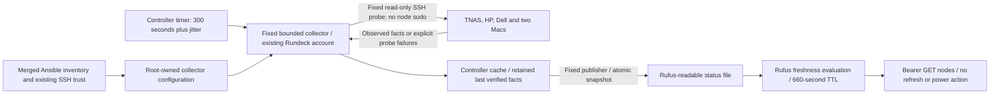

# Task 2 — compute discovery

Passive discovery only: no WOL, suspend, allocation, package installation or
configuration changes on any compute node, including the Ubuntu 20.04 Macs.

## Source and access

Combine the existing `Ansible/inventory/ai-inference.ini` (HP identity) with
`Ansible/inventory/compute.yml` (the other four nodes and eligibility/known facts).
`ai2.ini` supplies existing Rufus/controller deployment identities. HP is not
redefined. Ansible exports these merged host variables into the controller's
root-owned `/opt/rufus-discovery/config.json`. CPU/RAM/disks/OS/runtimes are
observed facts, not parallel hand-maintained hardware definitions.

The HP and Dell are general-purpose compute resources with preferred roles;
the Macs are shared long-haul workers. Configured supported workloads express
eligibility, not permission to submit work or proof of current readiness.

TNAS uses the existing `192.168.0.101` management endpoint because its hostname
currently does not resolve on Rundeck. Its reported hostname must still be `tnas`.
No DNS or network configuration is changed. Existing controller host keys are
reused, supplemented by the already-trusted operator records for Dell/Macs in
`Ansible/vars/node-discovery.yml`. Strict SSH host verification stays enabled.
Both Macs currently share an existing host key; the probe also checks hostname.

The dedicated fixed collector runs as the existing Rundeck automation identity
on the trusted controller, reusing its SSH key. It does not use sudo on nodes.
Its systemd unit prevents local privilege escalation and makes only its state
directory writable. Root owns its code, inventory export and trust file. This
retains the controller's existing administrative trust boundary: its existing
SSH key is an administrative credential, **not** a newly restricted key. That
credential is never copied into Rufus, its Web service, prompts or model tools.
No new credentials or Rundeck ACL permissions are introduced.

Only the fixed Linux probe is sent as stdin to `python3 -`. There are no model-
supplied hostnames, paths, arguments or commands. No collector endpoint is
exposed to the model. API queries only read the last snapshot. Read-only runtime
calls are `systemctl is-active/is-system-running` and Ollama GET requests. The
fixed publisher writes only `/var/lib/rufus-discovery/status/nodes.json` atomically
as the existing `rundeck` user. The Rufus group can read, not write, that directory.
No SSH/sudo permission is added to Rufus. Its bearer API remains loopback-only.

Mac SSH authorisation with the existing controller identity is unverified while
they are unreachable. When reachable the collector attempts the configured
identity, reporting authentication/host-key/probe failures honestly. It does not
install keys, create accounts or modify the Macs to repair access.

## Collection and read-only API flow



In words: a scheduled controller collector probes configured nodes and publishes
bounded snapshots. API reads evaluate freshness without network I/O. Unreachable
nodes are not assumed asleep; stale current metrics become unknown while dated
facts remain available. Inventory eligibility and reported readiness do not
authorise work allocation. No arrow here triggers WOL, suspend or scheduling.

## Facts and freshness

Each record separates:

- Configured hostname, SSH identity, machine type, preferred roles and workloads.
- `known_capabilities`: sourced inventory facts, with recorded/verified dates.
  Ubuntu 20.04 on both Macs is user-confirmed on 2 November 2026, not a live check.
  Unknown hardware is null; no Mac specifications are invented.
- `last_verified_capabilities`: CPU model, physical/logical cores, RAM, local
  filesystem capacity, actual OS/kernel, suspend support, runtime executables and
  Ollama models, plus the successful probe timestamp. Retained when offline.
- `observation`: current check timestamp, awake/SSH evidence, OS health,
  CPU/memory/swap/load, and per-workload availability. Failed checks clear current
  metrics without discarding previously verified capabilities.

Times in the API are UTC Unix seconds, except human-sourced known-fact dates.
Probe/last-success timestamps retain the controller clock. `received_at` uses
Rufus’s clock; `source_clock_offset_seconds` records the observed difference.
Freshness uses local time since receipt plus source probe age, so cross-host
clock skew does not falsely expire a new snapshot. No system clocks are changed.
`last_success_at` never advances on a failed probe. Disk entries are separate
mounts, not summed: ZFS datasets can share space. CPU is a 0.2-second sample;
RAM is OS-visible MemTotal, not a DIMM-slot audit; root capacity determines generic readiness. Thresholds are centrally
configurable. `degraded`/unknown OS health is conservatively unavailable. Runtime
executable detection searches PATH, not every virtual environment or filesystem.
Ollama is queried from the node itself, trying its existing loopback listener
first and then its inventory address, preserving the firewall. HP binds its LAN
address; Dell's existing service binds only 127.0.0.1. Returned endpoints are
relative to the probed node, not URLs Rufus may directly connect to. A stopped/unreachable runtime has unknown models, not an empty list
masquerading as verified absence. WOL support can remain known from prior evidence;
reading sysfs wake settings alone is not proof of WOL capability.

States: `online_available`, `online_busy`, `online_unavailable`, `sleeping`,
`unreachable`, `stale`. Workload readiness is separate: an otherwise usable CPU
node can be unavailable for inference if Ollama/models are absent. General OS
health does not establish spare capacity inside individual Proxmox guests.

Silence is **unreachable**, never sleeping by deduction. `sleeping` requires fresh,
explicit independent evidence (`compute_power_evidence`: state, observed_at and
source) in trusted inventory. It expires with the status TTL, and live SSH/ICMP
contradicts it. Task 2 creates no such evidence or power transitions; this is an
observation input, not a power-operation implementation.

The controller timer polls every 300 seconds with up to 15 seconds jitter. Three
parallel probes, two-second connection checks, bounded SSH/runtime requests, one
non-overlapping collector and a 120-second unit limit bound overhead. An awake
node is refreshed automatically on the next poll; no wake operation occurs.

Status expires after 660 seconds, including collector/publication failure. API
queries recompute staleness without doing network I/O: current metrics/availability
become unknown while known and last-verified facts remain explicitly historical.
A stale `last_observation` is labelled separately. Controller cache and published
snapshot survive service restarts. There is no unbounded status history.

## API and deployment

Existing bearer authentication on `127.0.0.1:8787` protects:

- `GET /nodes` — all configured compute nodes and freshness metadata.
- `GET /nodes/{id}` — one record (`tnas`, `ai-agent`, `ai-worker`, `server1`, `server2`).

Unknown nodes return 404; missing/invalid snapshots return 503. No POST, refresh,
command, allocation or power endpoint is provided. This task adds no Web page or
conversational tool; it establishes the read-only status API for Rufus.

As the existing administrator on the trusted controller, use the deployment route
with sudo (the runtime Rundeck account is not granted local sudo):

```bash
sudo ansible-playbook -i Ansible/inventory/ai2.ini --limit rufus --tags rufus_application Ansible/playbooks/rufus.yml
sudo ansible-playbook -i Ansible/inventory/ai-inference.ini -i Ansible/inventory/ai2.ini -i Ansible/inventory/compute.yml Ansible/playbooks/node-discovery.yml
```

Settings: `Ansible/vars/node-discovery.yml`. Timer/service: `rufus-discovery` on
Rundeck; code: `NodeDiscovery/`; API view: `Rufus/nodes.py`. An administrator may
request an early **read-only** refresh with `systemctl start rufus-discovery` on
Rundeck. Ordinary API queries do not refresh or execute jobs.

## Completion — 2 November 2026

Implemented/deployed source: `4f35528`, corrected through `3df2069`.
Controller timer and snapshot publication are operational. Final acceptance log:
`/tmp/node-discovery-final-w0kruryk.log` on Rundeck. Initial and corrected runs
passed all 76 existing Rufus regressions and 14 new discovery tests; only affected
tests/deployment stages were repeated after fixes, rather than rerunning all
existing tests each time. AI2 approval/rejection and AI3 persistence/failure
regressions remain intact; no live repair or inference generation was performed.

Live five-node API acceptance passed authenticated reads, individual records,
source facts, stale expiry with a controlled reader clock, read-only snapshot
permissions, and rejection of POST/refresh/command requests. Rufus's execution
count was unchanged. Simulated fresh/expired independent sleep evidence and
refresh-after-reachability recovery passed; no real sleep/wake transition was
performed or claimed. Clock-skew handling and both existing Ollama listener
patterns are independently covered by tests.

Observed snapshot (capacity values are a dated sample; query the API for current
values). CPU is physical cores / logical CPUs; RAM is OS-visible, not DIMM capacity.

| Node | CPU | Cores / logical | RAM GiB | Root free GiB | OS / observed status |
|---|---|---|---|---|---|
| tnas | i3-N305 | 8 / 8 | 31.1 | 866.3 | Debian 13 / Proxmox; awake, systemd degraded, conservatively unavailable |
| ai-agent | i5-6500T | 4 / 4 | 7.64 | 90.9 | Debian 13; online and available |
| ai-worker | i3-4160T | 2 / 4 | 7.68 | 43.3 | Debian 13; online and available |
| server1 | Unknown | Unknown | Unknown | Unknown | Unreachable; Ubuntu 20.04 is user-confirmed, not live-verified |
| server2 | Unknown | Unknown | Unknown | Unknown | Unreachable; Ubuntu 20.04 is user-confirmed, not live-verified |

Both HP/Dell have an active local Ollama service with `qwen3:4b`, digest
`359d7dd4bcdab3d86b87d73ac27966f4dbb9f5efdfcc75d34a8764a09474fae7`.
Dell's loopback-only listener was discovered without changing it. TNAS's existing
systemd degraded state was reported without diagnosing/repairing unrelated
services. Mac hardware and controller SSH authorisation remain unverified until
a trusted live probe can succeed; no specifications or sleep state were guessed.

No compute-node files, packages, accounts, SSH keys, OS, power settings or runtime
configuration were changed. Only the existing controller and Rufus guest received
the discovery implementation. No workload allocation, power-operation redesign,
Web enhancement or new model tool was added. Task 2 is closed with these explicit
availability/access limitations; fresh observations replace cached facts when
nodes subsequently become reachable and authenticated access succeeds.
