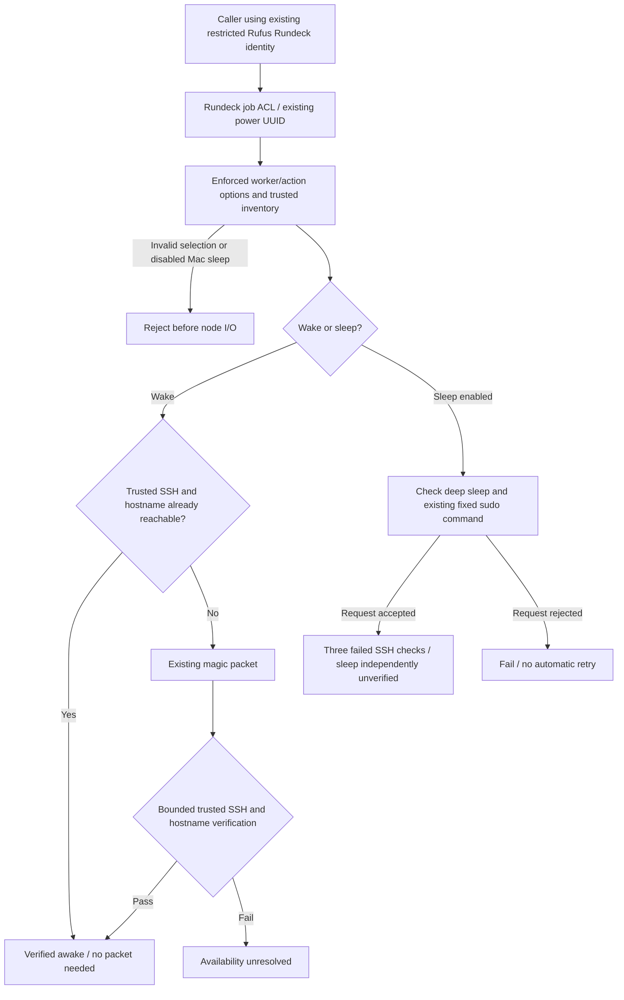

# Task 3 — existing worker power through Rundeck

## Existing mechanisms and scope

The deployed `HomeLab - AI Host Power` job, UUID
`7d9a3328-c8df-4e31-bbf6-49a6d9ce5a11`, already used
`Rundeck/scripts/power-ai-host.sh`: Python UDP magic packets on port 9 for
HP/Dell, followed by hostname-based SSH verification. Suspend checked deep/S3
and existing passwordless `sudo -n /usr/bin/systemctl --no-block suspend`, then
observed SSH disappearance. No replacement power mechanism was introduced.

Existing operator WOL commands in `CRAP/Notes.txt` supply the Mac MACs and
`192.168.0.255` broadcast. HP/Dell retain their original broadcast. These values
now live in the existing shared `Ansible/inventory/compute.yml`, alongside
explicit per-worker suspend enablement. The existing merged Ansible inventory
continues to supply SSH addresses, user and host-key aliases. TNAS is excluded.
Both Macs remain Ubuntu 20.04, operator-confirmed sleeping. No Mac suspend
mechanism/access was verified: their suspend requests fail before any node I/O.
Mac wake is configured from the existing commands but deliberately not exercised.

## Deployment and access

Run on the trusted controller in an authorised source checkout/bundle:

```bash
sudo ansible-playbook -i Ansible/inventory/ai-inference.ini -i Ansible/inventory/ai2.ini -i Ansible/inventory/compute.yml Ansible/playbooks/worker-power.yml
```

The controller-only playbook installs root-owned `/opt/rufus-power` code/config,
reuses `/opt/rufus-discovery/known_hosts`, imports the existing job preserving its
UUID using the existing administrator token, and installs the existing Rufus ACL
with one added job `read,run` grant. It does not contact/configure workers, add
worker sudo permissions, create credentials or change secrets-file metadata.
Job import always reconciles the definition; configuration/file copies are
idempotent. Existing filesystem ACL changes may take up to two minutes to reload; the
acceptance script waits for the grant before submitting jobs. No Rundeck restart
is needed ([Rundeck ACL lifecycle](https://docs.rundeck.com/6.3.0/administration/security/authorization.html)).

The script now verifies trusted SSH keys and remote hostname. It reuses the
controller's existing administrative SSH identity, which never enters Rufus or
model context. Its allowed commands are fixed; job input selects only an
inventory worker and `wake`/`sleep`. There are no supplied shell commands,
addresses, MACs or credentials in job options. No new controller/worker sudo
rules are installed. Existing unrelated ACL rights remain unchanged.

Using Rufus's existing restricted Rundeck API identity:

```http
POST /api/50/job/7d9a3328-c8df-4e31-bbf6-49a6d9ce5a11/run
Content-Type: application/json
X-Rundeck-Auth-Token: <existing restricted token>

{"options":{"vmname":"ai-agent","action":"wake"}}
```

`vmname`: `ai-agent`, `ai-worker`, `server1`, `server2`.
`action`: `wake`, `sleep` (Mac sleep rejected until verified/enabled).
Poll `GET /api/50/execution/{id}` and read
`GET /api/50/execution/{id}/output?format=json`. Both are scoped by existing job
read access. Unexpected worker/action values are rejected by enforced job
options and the script's inventory/action checks.

This completes the Rundeck side. The Rufus application policy, conversational
classifier, approval workflow and Web UI are unchanged; this task does not add
a chat command, automatic wake, scheduling, or an application-level power API.
A later Rufus client can use this restricted job contract without worker SSH.
Do not infer a new chat command from the Rundeck ACL grant.

## Power-control boundary and availability flow



In words: inventory and ACL checks constrain a fixed controller-side mechanism;
Rufus receives no worker SSH key. A packet is not wake proof and disappearance
alone is not independent sleep proof. The separate acceptance record below adds
kernel/DHCP evidence for HP/Dell. Task 3 grants Rundeck-side access only: the
Rufus application catalogue, chat approval workflow and passive discovery cache
do not gain a power command or automatic orchestration from this grant.

## Result semantics

- An already reachable host succeeds without sending an unnecessary packet.
- Wake succeeds only after SSH reports the selected hostname. Packet transmission
  alone is not verified wake. Failed SSH verification leaves availability
  unresolved; DNS/authentication failure does not establish hardware wake failure.
- Suspend success means the fixed request returned zero and three subsequent SSH
  attempts failed. Output explicitly labels actual sleep as independently
  unverified. Rejected requests cannot become successful merely because SSH then
  fails. No automatic retry of a possibly applied suspend request is performed.
- Discovery retains its passive semantics. Power-job output does not fabricate
  independent sleep evidence or change the discovery cache.

## Validation and deployment record

Controller deployment and automated tests passed on 3 November 2026. Initial
live failures and the successful DHCP-resume follow-up are recorded below. The reusable
`scripts/worker-power-acceptance.py` runs existing Rundeck and Rufus regressions
(including discovery), shell syntax, controller deployment, restricted-token
read/denial checks, invalid-worker rejection, and HP/Dell wake, suspend and
wake again. It checks independent kernel suspend/resume evidence, fresh DHCP
ACKs and short/FQDN resolution. It retains its exclusively created log after
closing it and reports compact results. It intentionally performs real HP/Dell power transitions and must only
be run when those workers can be interrupted. It never wakes or contacts Macs.

Initial acceptance evidence (superseded by the successful follow-up below):

- Existing Rundeck tests plus focused power tests: **21 passed**. Existing Rufus
  regressions, including passive discovery and AI2/AI3: **90 passed**. Shell syntax
  passed. Log on Rundeck: `/tmp/worker-power-final-mg997s00.log`.
- Controller-only Ansible deployment: `ok=8 changed=4 failed=0`; existing job UUID
  preserved. No controller Git checkout changes, service restart or worker
  configuration changes.
- The first restricted read encountered the old cached ACL. After reload, the
  active Rufus token could read the power job, could not read the unrelated VM
  job, and invalid `tnas` worker selection was rejected by Rundeck.
- Execution **204**: `server1 sleep` rejected by the disabled-inventory gate
  before SSH or WOL. This does not constitute a Mac power operation.
- Execution **205**: HP wake sent the existing packet; all hostname-based SSH
  checks failed. Controller DNS lookup had no answer for `ai-agent.lan`.
  Availability remained unresolved; actual hardware wake failure is not proven.
  HP suspend was not attempted. Live log: `/tmp/worker-power-final-lgv8f_79.log`.
- Execution **206**: Dell wake sent the existing packet, but hostname-based SSH
  verification failed. Controller lookup also had no answer for `ai-worker`.
  Dell suspend was skipped. Log: `/tmp/worker-power-final-iqmxil9m.log`.
- **Live end-to-end power acceptance did not pass.** Neither worker's current
  awake state could be established. There was no retry using an IP address,
  network/SSH repair, or live suspend attempt. The fake-SSH tests cover accepted
  suspend/disconnect, rejected requests, identity mismatch, wake recovery and
  unavailable verification; these are not substitutes for live power proof.

The initial HP/Dell availability and hostname-publication blocker was resolved
by the DHCP-resume fix and successful live acceptance recorded below. No further
HP/Dell power test is outstanding for Task 3.
Mac wake and suspend access/mechanism verification require a separately available
maintenance opportunity; the Macs were deliberately not awakened for this task.

Files: shared compute inventory; new `worker-power.yml` playbook and
`worker-power.json.j2` template; existing power script/job and Rufus ACL;
`tests/rundeck/test_worker_power.py`; acceptance script; this document and
`Rundeck/README.md`.

The acceptance deployment used a source bundle and did not update the controller
Git checkout or GitHub. The final Task 3 cleanup is authorised for one local
commit; pushing remains unauthorised. A future refresh from the old
GitHub revision may restore the old job/ACL until these changes are committed
and pushed under a separate instruction. Mac suspend prerequisites and live Mac
wake/access verification remain deferred until the operator makes them available.

## Follow-up — DHCP registration after resume, 3 November 2026

The initial power failures above are superseded by the following diagnosis and
fix; they were not evidence that WOL failed. Initial inspection showed:

- Shared inventory expects HP `ai-agent.lan` and Dell `ai-worker` (with controller
  search domain `lan`); neither has a fixed `ansible_host` IP. The controller uses
  Pi-hole `192.168.0.2`, as intended. Direct Pi-hole queries returned NXDOMAIN.
- HP was awake at `192.168.0.118`, matched by MAC, trusted SSH host key and hostname.
  Dell was subsequently reachable at `192.168.0.34` with matching key/hostname.
  Neither inventory nor known-host records was incorrect.
- Both use the existing `networking.service`/ifupdown and a single dhclient.
  Their saved leases expired overnight (HP 2 November 21:43:25; Dell 21:31:46).
  They resumed at approximately 09:07/09:09 on 3 November but did not immediately
  refresh DHCP registration. HP retained its old address with no DHCP ACK since
  the previous evening. Dell reacquired its lease at 09:12:26, after which its
  Pi-hole hostname resolved again. This establishes delayed DHCP/DNS recovery
  after resume, not a controller resolver or SSH authentication problem.

`Ansible/playbooks/worker-resume-network.yml` targets only `ai-agent.lan` and
`ai-worker`. It verifies the existing manager/client, then installs this root-owned
file on each worker:

`/etc/systemd/system/systemd-suspend.service.d/20-homelab-dhcp-resume.conf`

```ini
[Service]
ExecStartPost=/usr/bin/systemctl --no-block restart networking.service
```

The existing network manager refreshes its own DHCP client on resume; no parallel
client, static address, hosts-file entry, Pi-hole change or VM-template change is
introduced. The existing suspend command and magic-packet mechanism are retained.
`ExecStartPost` runs after the successful oneshot sleep operation returns
([systemd service documentation](https://www.freedesktop.org/software/systemd/man/latest/systemd.service.html)).

Apply through the existing trusted controller:

```bash
sudo ansible-playbook -i Ansible/inventory/ai-inference.ini -i Ansible/inventory/ai2.ini -i Ansible/inventory/compute.yml Ansible/playbooks/worker-resume-network.yml
```

Initial repair used a one-use controller inventory overlay with the MAC/key/
hostname-verified HP/Dell addresses because their DNS names were absent. It was
removed after deployment; shared inventory and job endpoints still use hostnames.
The initial manager refresh immediately restored authoritative Pi-hole records
for HP `192.168.0.118` and Dell `192.168.0.34`.

The acceptance script now tests HP/Dell only: wake, suspend with three failed SSH
checks, wake again, short/FQDN resolution, independent kernel deep-suspend/resume
records and a fresh DHCP ACK. It leaves both tested workers awake. It no longer
submits even a deliberately rejected Mac request. Detailed final results follow.

Final result: **PASS**, 3 November 2026, using the existing restricted Rufus token.

| Worker | Initial wake | Suspend / SSH disappearance | Wake after suspend | Independent evidence |
|---|---|---|---|---|
| HP | [207](http://192.168.0.51:4440/project/HomeLab/execution/show/207), already awake | [208](http://192.168.0.51:4440/project/HomeLab/execution/show/208), passed | [209](http://192.168.0.51:4440/project/HomeLab/execution/show/209), verified | Kernel deep-suspend entry and resume; new DHCP ACK; short/FQDN DNS |
| Dell | [210](http://192.168.0.51:4440/project/HomeLab/execution/show/210), already awake | [211](http://192.168.0.51:4440/project/HomeLab/execution/show/211), passed | [212](http://192.168.0.51:4440/project/HomeLab/execution/show/212), verified | Kernel deep-suspend entry and resume; new DHCP ACK; short/FQDN DNS |

The single controller-side final validation call applied the resume fix, checked
both authoritative DNS records, passed all **21 relevant Rundeck/power tests**,
and ran HP/Dell live acceptance. Detailed logs on Rundeck:
`/tmp/worker-resume-deploy-ihgdCa.log` and
`/tmp/worker-power-final-29lcuxgl.log`. Git diff whitespace validation also passed.
The earlier 90 Rufus regressions were not repeated because this continuation did
not change Rufus application code or permissions. No lease-length/overnight wait
or worker reboot was performed; fresh DHCP after actual resume was verified.

The Rundeck integration and HP/Dell live acceptance are complete. Both workers
were left awake. Mac wake remains deliberately untested and Mac suspend remains
disabled pending its existing access/mechanism verification. No Mac was contacted
by this continuation. No Pi-hole/DHCP server settings, hosts files, shared worker
addresses, SSH trust, Rufus permissions, templates or power-job mechanisms changed.
All prior working changes are preserved. The final cleanup is authorised for
one local Task 3 commit, with no push. Until a separately authorised push, the
previous note about Git refresh restoring an older job still applies.
